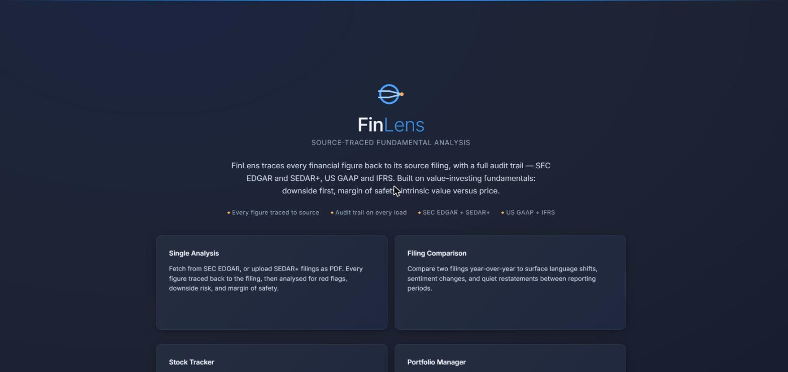
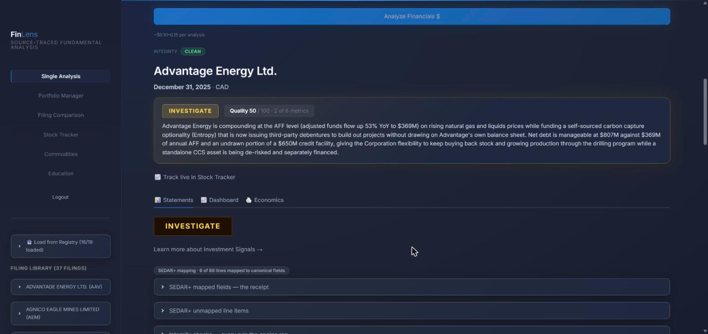
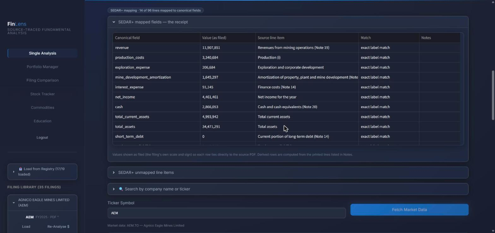
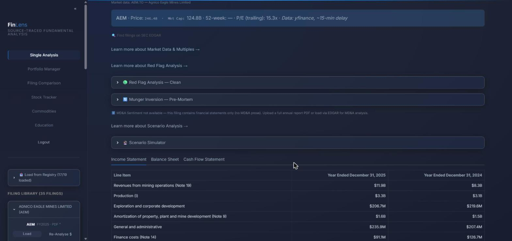
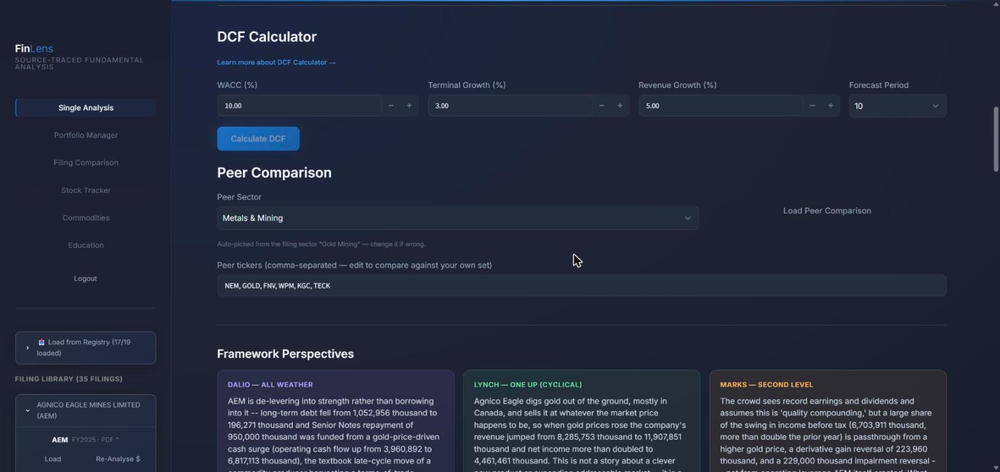

# FinLens

Source-traced fundamental analysis. FinLens reads a company's filing, pulls every figure out with a receipt that points back to the printed line, checks the numbers against each other, and only then lets a model form a view.



## What it does

1. **Gets the filing.** Fetch from SEC EDGAR, upload a SEDAR+ PDF, or name the company and let an agent find the PDF on the issuer's own investor-relations page and record a sha256 receipt for the bytes.
2. **Extracts the statements.** Claude reads the income statement, balance sheet and cash flow and returns the figures as filed, in the filing's own scale and sign. US GAAP and IFRS both work.
3. **Maps labels to canonical fields and shows its work.** Every mapped line carries the source label and the match type. Unmapped lines are listed, never dropped. On Agnico Eagle's FY2025 statements that is 14 of 96 lines mapped, and the other 82 are one click away.
4. **Checks the numbers.** The integrity engine is pure arithmetic: subtotals, signs, cross-statement ties, sector-aware rules. It flags and warns. It never changes a figure.
5. **Then analyses.** Red flags, a quality score, beta, DCF, peer comparison, a scenario simulator, a Munger-style pre-mortem, and three framework readings of the same numbers (Dalio, Lynch, Marks). Export a report or a one-page investment memo to Word.

**Skipping SEDAR+.** Canadian filings live on SEDAR+, which is slow to search and makes you click through a CAPTCHA and download by hand. Name the company instead and an agent finds the statements on the issuer's own site. FinLens downloads the bytes itself, checks they are a PDF, and keeps a sha256 receipt with the URL, the size and the time. On 27 October 2026 it found Advantage Energy's audited 2025 statements on advantageog.com in 45 seconds, and the analysis below was on screen four minutes after the first click.









## Sample output

You do not need an API key to see what comes out. `docs/samples/` holds one complete run on Agnico Eagle Mines' FY2025 annual report (SEDAR+, IFRS, USD), generated from the saved analysis with no model call:

- [Investment memo, rendered as Markdown](docs/samples/FinLens_Memo_Agnico_Eagle_FY2025.md): signal, thesis, financials at a glance, health checks, valuation multiples, bull and bear cases.
- [The same memo as Word](docs/samples/FinLens_Memo_Agnico_Eagle_FY2025.docx), the one-page document the app exports.
- [The Excel report](docs/samples/FinLens_Report_Agnico_Eagle_FY2025.xlsx): summary, key ratios, and the three statements as filed, two years side by side.

Market data in the samples is from the export date, not the filing date, and the caption on the memo says which listing and currency it came from.

## How it works

```
filing (EDGAR, SEDAR+ PDF, or agent fetch)
  -> page locator (pdfplumber)
  -> Claude extraction (as filed, scale and currency captured)
  -> IFRS and US GAAP alias mapping, with a receipt per line
  -> normalize_and_validate()
  -> integrity engine (flag and warn, no mutation, no API calls)
  -> analysis and valuation
```

**Models are tiered by job.** A small model does structured extraction, a larger one does analysis, and an optional second extractor (Gemini) cross-checks a filing so a human only reviews the lines the two disagree on. Extraction is paid once per filing and cached. A full run costs cents, not dollars.

**The corpus is the product.** Every filing that passes through the engine stays in a validated library (35 filings today, mostly Canadian issuers that have no XBRL). Judgment calls about what a line means are written down in an adjudication casebook with the evidence, so the next person does not re-decide them.

## Where it loses

- Canadian filings are PDFs with no machine-readable tags, so coverage grows one issuer at a time and the alias table grows by adjudication. A new sector means new labels.
- Agent fetch depends on issuer websites behaving. Some block it.
- The library was built by one person. The commercial model has clients grow it; today it is thin.
- Mapping is conservative on purpose. Fewer lines mapped with a receipt beats more lines mapped by guesswork, and the number on screen says which.

## How it is built

- 752 offline tests, run on every push on Python 3.11 and 3.13 (`.github/workflows/integrity.yml`), plus ruff as a lint gate and a pre-commit hook.
- `CLAUDE.md` is the engineering contract: what the app is, the rules every change follows, and the principle that working code with captured evidence outranks a documentation argument.
- `docs/` holds the design specs, dated audits and design briefs behind the bigger decisions, and the adjudication casebook.
- Built with Claude Code, with other models used for review and second opinions. The commit history shows how.

## Run it

Python 3.11 or newer.

```
pip install -r requirements.txt
```

Set two values, in `.streamlit/secrets.toml` or the environment (see `.env.example`):

```
ANTHROPIC_API_KEY=...
APP_PASSWORD=...
```

Then:

```
streamlit run app.py
```

Optional: `GEMINI_API_KEY` for the cross-check extractor, and the agent-fetch gateway settings described in `.env.example`. `DOCKER.md` covers the container.

## What I would do next

Lot-level position tracking, a catalyst calendar, and a memo builder that drafts from the mapped figures instead of the raw text. The roadmap files in the repository root carry the longer list and the pricing thinking behind it.

## Licence

All rights reserved. The code is published so it can be read and reviewed. It is not licensed for reuse.

Riley Orman, Calgary. [LinkedIn](https://www.linkedin.com/in/riley-orman-mba)
